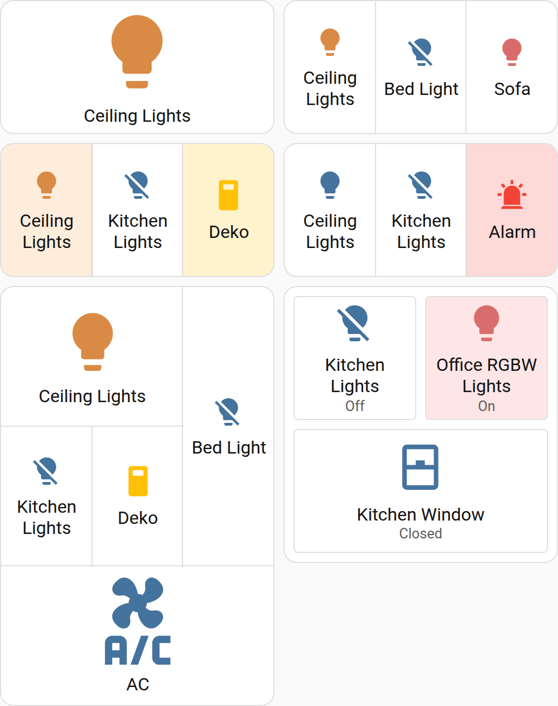
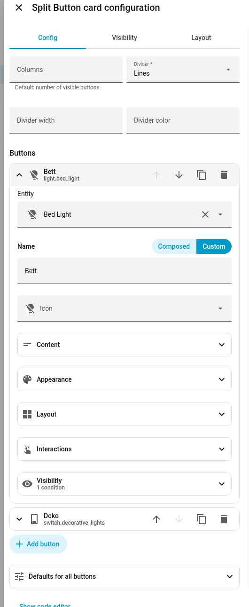
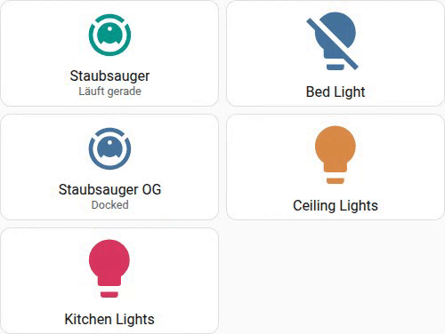

# Split Button Card

[](https://hacs.xyz)
[](https://github.com/Hudint/split-button-card/actions/workflows/build.yml)

A Home Assistant dashboard card that looks exactly like the native **button card**, but is split into multiple sub-buttons. Every sub-button has its own icon, name, entity, color and actions.

<picture>
  <source media="(prefers-color-scheme: dark)" srcset="docs/screenshot-dark.png">
  
</picture>

## Features

- Pixel-identical to the native button card: same icon sizing, ripple, focus ring, theme variables and state colors.
- Takes the same space as a native button in section dashboards (6 × 2), so it can replace one 1:1.
- Free grid layout with `columns`, plus `span` / `row_span` per sub-button.
- Dividers that match the card border by default, or short lines, gaps or nothing.
- State coloring of icon and/or background, with custom colors and opacity.
- `tap_action`, `hold_action` and `double_tap_action` with all standard Home Assistant actions.
- Per-button visibility conditions: the card hides itself when no button is visible.
- Custom pictures, JavaScript templates (button-card syntax) and animations per button.
- Switch style: the button fills with color when turned on, with a wipe animation, and separate icons for on and off.
- Mini switch: a small version of the tile card's toggle below icon, name and state.
- Menus: tapping a button splits it into its own sub-buttons, nested as deep as you like. The open menu is local to each browser.
- Visual editor: configure everything in the dashboard UI, no YAML needed.

## Installation

### HACS (recommended)

[](https://my.home-assistant.io/redirect/hacs_repository/?owner=Hudint&repository=split-button-card&category=plugin)

1. Open HACS and search for **Split Button Card**.
2. Install it and reload the browser.

<details>
<summary>Card not found in HACS? Add it as a custom repository</summary>

1. HACS → ⋮ → *Custom repositories* → add `https://github.com/Hudint/split-button-card` with type **Dashboard**.
2. Install **Split Button Card** and reload the browser.

</details>

### Manual

1. Download `split-button-card.js` from the [latest release](https://github.com/Hudint/split-button-card/releases/latest) and copy it to `/config/www/`.
2. Settings → Dashboards → ⋮ → *Resources* → add `/local/split-button-card.js` as **JavaScript module**.

## Configuration

### Visual editor

Add the card via *Add card → Split Button Card* and configure it in the UI. Buttons can be added, reordered, duplicated and removed. Each button shows entity, name and icon up front; everything else sits in collapsible sections (*Content*, *Appearance*, *Layout*, *Interactions*, *Visibility*), using the same pickers as the native button card. *Defaults for all buttons* below the list sets options for every button at once.



### YAML

```yaml
type: custom:split-button-card
buttons:
  - entity: light.living_room
  - entity: light.kitchen
    name: Küche
  - name: Szene
    icon: mdi:palette
    tap_action:
      action: perform-action
      perform_action: scene.turn_on
      target:
        entity_id: scene.evening
```

### Card options

| Option               | Type    | Default           | Description                                                                                          |
| -------------------- | ------- | ----------------- | ---------------------------------------------------------------------------------------------------- |
| `buttons`            | list    | **required**      | The sub-buttons, see below.                                                                          |
| `columns`            | number  | number of buttons | Grid columns. Further buttons wrap into additional rows.                                             |
| `divider`            | string  | `border`          | `border`: lines like the card border · `line`: short inset lines · `gap`: separate tiles · `none`   |
| `divider_width`      | string  | card border width | Width of the divider lines, e.g. `2px`.                                                              |
| `divider_color`      | string  | card border color | Color of the divider lines (any CSS color).                                                          |
| `gap`                | string  | `8px`             | Spacing for `divider: gap`.                                                                          |
| `menu_timeout`       | number  | `15`              | Seconds without interaction after which an open menu returns to the start. `0` = never.             |
| `menu_back`          | string  | `left`            | Back button of an open menu: `left`, `right`, `top`, `bottom` (strip), `top_left`, `top_right`, `bottom_left`, `bottom_right` (round corner button), `start`, `end` (a regular button before / after the menu buttons) or `none`. |
| `menu_back_icon`     | string  | `mdi:chevron-left` | Icon of the back button (`mdi:arrow-left` for corner and button styles).                            |
| `menu_back_color`    | string  | secondary text    | Color of the back button (theme color or any CSS color).                                             |
| `menu_back_size`     | string  | `32px` / `28px`   | Width of the strip or size of the corner button.                                                     |
| `menu_back_name`     | string  | „Back“ (localized) | Text of the back button for `start` / `end`.                                                        |
| `menu_resize`        | boolean | `false`           | Resize the card to the open menu. Otherwise it keeps the size of its largest menu.                   |
| `menu_close_on_action` | boolean | `true`          | Return to the start after a menu button ran its action.                                              |

These options can be set on the card as default for all buttons, and overridden per button:
`show_name`, `show_icon`, `show_state`, `icon_height`, `color`, `state_color`, `state_background`, `background_opacity`, `show_entity_picture`, `state_display`, `animation`, `switch_style`, `switch_animation`, `switch_text_color`, `show_toggle`, `toggle_color`, `toggle_icon_on`, `toggle_icon_off`.

### Button options

| Option               | Type    | Default                                            | Description                                                                                         |
| -------------------- | ------- | -------------------------------------------------- | --------------------------------------------------------------------------------------------------- |
| `entity`             | string  |                                                    | Entity shown and controlled by this button.                                                         |
| `name`               | string  | entity name                                        | Text below the icon.                                                                                |
| `icon`               | string  | entity icon                                        | Any `mdi:` icon.                                                                                    |
| `icon_on`            | string  | `icon`                                             | Icon while the entity is on (active: light on, cover open, …).                                      |
| `icon_off`           | string  | `icon`                                             | Icon while the entity is off.                                                                       |
| `show_name`          | boolean | `true`                                             |                                                                                                     |
| `show_icon`          | boolean | `true`                                             |                                                                                                     |
| `show_state`         | boolean | `false`                                            | Show the entity state below the name.                                                               |
| `icon_height`        | string  |                                                    | e.g. `48px`.                                                                                        |
| `color`              | string  | state color                                        | Color when active: a theme color (`amber`, `red`, `primary`, …) or any CSS color. Without an entity it is always applied. |
| `state_color`        | boolean | `true`                                             | Color the icon by state, like the native button.                                                    |
| `state_background`   | boolean | `false`                                            | Tint the background with the state color while active.                                             |
| `background_opacity` | number  | `0.2`                                              | Opacity of the background tint.                                                                     |
| `entity_picture`     | string  |                                                    | Picture URL shown instead of the icon, e.g. `/local/waste/yellow.png`.                              |
| `show_entity_picture`| boolean | `false`                                            | Show the entity's own picture (e.g. person, media player) instead of the icon.                     |
| `state_display`      | string  | formatted state                                    | Text shown as state. Plain text or a JavaScript template, see below.                               |
| `animation`          | string  |                                                    | `bounce`, `pulse`, `shake` or `blink`.                                                              |
| `switch_style`       | boolean | `false`                                            | Fill the whole button with `color` (default: state color) while on, like a switch.                  |
| `switch_animation`   | string  | `left`                                             | How the fill appears: `left` / `bottom` (wipe), `tap` (circle from where you tapped) or `fade`.     |
| `switch_text_color`  | string  | `white`                                            | Icon and text color while filled (theme color or any CSS color).                                    |
| `show_toggle`        | boolean | `false`                                            | Show a small switch below the text, styled like the tile card's toggle.                             |
| `toggle_color`       | string  | state color                                        | Switch color while on.                                                                              |
| `toggle_icon_on`     | string  | domain icon                                        | Icon on the switch while on (lightbulb for lights, fan for fans, otherwise power).                  |
| `toggle_icon_off`    | string  | domain icon                                        | Icon on the switch while off.                                                                       |
| `visibility`         | list    |                                                    | Conditions like the card [visibility](https://www.home-assistant.io/dashboards/cards/#showing-or-hiding-a-card-conditionally) option. Conditions without `entity` use the button's entity. |
| `span`               | number  | `1`                                                | Grid columns this button occupies.                                                                  |
| `row_span`           | number  | `1`                                                | Grid rows this button occupies.                                                                     |
| `tap_action`         | action  | `toggle` for toggleable entities, else `more-info` | Standard [Home Assistant action](https://www.home-assistant.io/dashboards/actions/).               |
| `hold_action`        | action  | `more-info`                                        |                                                                                                     |
| `double_tap_action`  | action  | `none`                                             |                                                                                                     |
| `buttons`            | list    |                                                    | Sub-buttons, see [Menus](#menus). Same options as a button.                                         |
| `menu_open`          | string  | `tap`                                              | Gesture that opens the menu: `tap`, `hold` or `double_tap`.                                         |
| `menu_columns`       | number  | number of buttons                                  | Grid columns of the menu.                                                                           |
| `menu_close_on_action` | boolean | card setting                                     | Overrides `menu_close_on_action` for this menu.                                                     |

### Switch style

```yaml
type: custom:split-button-card
switch_style: true
buttons:
  - entity: light.living_room
    icon_on: mdi:lightbulb-on
    icon_off: mdi:lightbulb-outline
  - entity: switch.coffee_machine
    color: green
    switch_animation: bottom
```

The fill duration can be changed with the CSS variable `--sbc-switch-duration` (default `400ms`).

### Mini switch

```yaml
type: custom:split-button-card
show_state: true
show_toggle: true
toggle_color: green
buttons:
  - entity: light.ceiling
  - entity: light.bed
  - entity: switch.decoration
```

The whole button stays the switch; the mini switch shows the state. Its size can be changed with `--sbc-toggle-width`, `--sbc-toggle-height` and `--sbc-toggle-radius`.

### Menus

<picture>
  <source media="(prefers-color-scheme: dark)" srcset="docs/menu-dark.gif">
  
</picture>

A button with its own `buttons` becomes a menu: tapping it replaces the card's buttons with its sub-buttons, which split out of the tapped button. Menus can be nested. A back button returns one level (strip on any side, corner button or a regular button, see `menu_back`), and the menu closes on its own after an action or after `menu_timeout` seconds. Which menu is open is kept in the browser only, so everybody using the dashboard navigates independently.

```yaml
type: custom:split-button-card
buttons:
  - entity: vacuum.robi
    name: Staubsauger
    show_state: true
    state_display: "[[[ return entity.state === 'cleaning' ? 'Läuft gerade' : 'Läuft um 10:00'; ]]]"
    buttons:
      - name: Jetzt starten
        icon: mdi:play
        tap_action:
          action: perform-action
          perform_action: vacuum.start
          target: { entity_id: vacuum.robi }
      - name: Heute auslassen
        icon: mdi:calendar-remove
        tap_action:
          action: toggle
          entity: input_boolean.robi_skip_today
      - name: Raum
        icon: mdi:floor-plan
        buttons:
          - name: Küche
            icon: mdi:countertop
            tap_action:
              action: perform-action
              perform_action: script.robi_clean_room
              data: { room: kitchen }
          - name: Bad
            icon: mdi:shower
            tap_action:
              action: perform-action
              perform_action: script.robi_clean_room
              data: { room: bathroom }
```

By default the card keeps the size of its largest menu, so the dashboard does not move. With `menu_resize: true` it grows and shrinks with the open menu in sections dashboards (unless the card has a fixed size under *Layout*). The corner button's background can be changed with `--sbc-back-background`.

### Templates

`name`, `icon`, `color`, `entity_picture` and `state_display` accept JavaScript templates in [button-card](https://github.com/custom-cards/button-card#javascript-templates) syntax, so existing templates can be copied over. Available variables: `entity` (the button's entity), `states`, `hass`, `user`.

```yaml
state_display: |
  [[[
    const days = Number(entity.state);
    if (days === 0) return "Heute";
    if (days === 1) return "Morgen";
    return `in ${days} Tagen`;
  ]]]
color: "[[[ return Number(entity.state) === 0 ? 'red' : 'orange'; ]]]"
```

### Styling

Fonts can be adjusted with CSS variables, e.g. with [card-mod](https://github.com/thomasloven/lovelace-card-mod):

```yaml
card_mod:
  style: |
    ha-card {
      --sbc-name-font-weight: 600;
      --sbc-name-font-size: 16px;
      --sbc-state-font-size: 14px;
    }
```

Also available: `--sbc-state-font-weight`.

## Examples

### Waste collection

Only bins picked up within the next two days are shown; the card disappears when none is due.

```yaml
type: custom:split-button-card
show_state: true
state_background: true
background_opacity: 1
icon_height: 52px
animation: bounce
state_display: |
  [[[
    const days = Number(entity.state);
    if (Number.isNaN(days)) return entity.state;
    if (days < 0) return "Vorbei";
    if (days === 0) return "Heute";
    if (days === 1) return "Morgen";
    return `in ${days} Tagen`;
  ]]]
buttons:
  - entity: sensor.waste_collection_schedule_gelbe_tonne
    name: Gelbe Tonne
    entity_picture: /local/waste/yellow.png
    color: "#645d16"
    visibility:
      - condition: numeric_state
        below: 3
  - entity: sensor.waste_collection_schedule_altpapier
    name: Altpapier
    entity_picture: /local/waste/blue.png
    color: "#022845"
    visibility:
      - condition: numeric_state
        below: 3
```

### Cover control

```yaml
type: custom:split-button-card
divider: line
buttons:
  - name: Hoch
    icon: mdi:arrow-up
    tap_action:
      action: perform-action
      perform_action: cover.open_cover
      target: { entity_id: cover.living_room }
  - name: Stop
    icon: mdi:stop
    tap_action:
      action: perform-action
      perform_action: cover.stop_cover
      target: { entity_id: cover.living_room }
  - name: Runter
    icon: mdi:arrow-down
    tap_action:
      action: perform-action
      perform_action: cover.close_cover
      target: { entity_id: cover.living_room }
```

### Lights with background tint

```yaml
type: custom:split-button-card
state_background: true
buttons:
  - entity: light.ceiling
  - entity: light.kitchen
  - entity: switch.decoration
    name: Deko
```

### Grid with spans

```yaml
type: custom:split-button-card
columns: 3
buttons:
  - entity: light.ceiling
    span: 2
  - entity: light.bed
    row_span: 2
  - entity: light.kitchen
  - entity: switch.decoration
  - entity: climate.living_room
    span: 3
```

### Separate tiles

```yaml
type: custom:split-button-card
divider: gap
columns: 2
buttons:
  - entity: light.kitchen
    show_state: true
  - entity: light.office
    show_state: true
  - entity: cover.kitchen_window
    show_state: true
    span: 2
```

## Development

```bash
npm install
npm run build        # → dist/split-button-card.js
npm run watch        # rebuild on change
./dev/start-ha.sh    # local Home Assistant with demo entities on http://127.0.0.1:18123
```

Releases are built by GitHub Actions: publishing a GitHub release attaches `split-button-card.js` to it, which HACS then installs.
